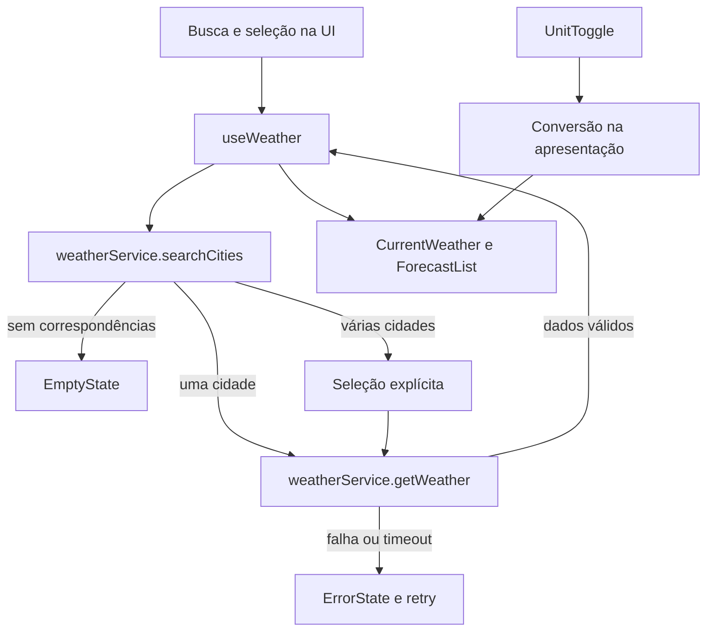

# Plano Técnico do Weather App

## 1. Architecture Overview

Aplicação SPA em React, organizada em camadas e com fluxo de dados unidirecional. O plano parte da estrutura existente em `src/` e evita adicionar bibliotecas de estado ou de acesso HTTP sem necessidade.

| Camada | Responsabilidade | Implementação |
| --- | --- | --- |
| Apresentação | Busca, seleção de cidade, clima atual, previsão e estados visuais | `src/components/`, `src/App.tsx` |
| Orquestração | Coordenar busca, seleção, consulta meteorológica, retry e status | `src/hooks/useWeather.ts` |
| Acesso a dados | Consultar APIs, validar respostas e mapear DTOs para o domínio | `src/services/weatherService.ts` |
| Domínio e apresentação | Tipos compartilhados, conversão de temperatura, códigos e formatação | `src/types/`, `src/lib/` |



**Regra de desambiguação:** se o geocoding retornar várias cidades, apresentar opções identificadas por cidade, região e país e aguardar seleção; não carregar automaticamente o primeiro resultado. Se retornar exatamente uma cidade, a seleção automática é aceitável, mantendo a identidade da cidade visível. Isso atende RF-02 e reduz uma etapa desnecessária para buscas não ambíguas.

## 2. Tech Stack

| Área | Tecnologia | Justificativa |
| --- | --- | --- |
| Linguagem | TypeScript strict | Tipos explícitos para domínio e fronteira com APIs externas. |
| UI | React 19 + Vite | Stack já instalada e usada pelo app; adequado a uma SPA estática. |
| Estilo | Tailwind CSS 3 | Já integrado ao projeto e aos componentes atuais. |
| Testes unitários e de componentes | Vitest + Testing Library | Já instalados; permitem testar serviço e comportamento acessível da UI. |
| Testes de navegador | Playwright | Já configurado com projetos desktop e mobile. |
| Dados meteorológicos | Open-Meteo Geocoding e Forecast | Já consumido por `weatherService.ts`; não exige chave de API para o fluxo atual. |
| Dependências de estado/rede | Nenhuma adicional | O hook e `fetch` nativos são suficientes para o escopo v1. |

## 3. Project Structure

Manter a estrutura existente. As responsabilidades abaixo servem como contrato para a implementação e para tarefas subsequentes.

```text
src/
├── App.tsx                         # Composição da tela e estado de unidade
├── components/
│   ├── SearchBar.tsx               # Entrada e envio da busca
│   ├── CityResults.tsx             # Opções de geocoding, se houver ambiguidade
│   ├── CurrentWeather.tsx          # Condições atuais da cidade selecionada
│   ├── ForecastList.tsx            # Lista dos cinco dias
│   ├── ForecastCard.tsx            # Dados de um dia
│   ├── UnitToggle.tsx              # Seleção Celsius/Fahrenheit
│   └── states/                     # Loading, erro e estado vazio
├── hooks/
│   └── useWeather.ts               # Máquina de estados e orquestração
├── lib/
│   ├── format.ts                   # Formatação de data e valores ausentes
│   ├── temperature.ts              # Conversão de temperatura
│   └── weatherCodes.ts             # Código meteorológico para rótulo/ícone
├── services/
│   └── weatherService.ts           # HTTP, validação e mapeamento das APIs
└── types/
    └── weather.ts                  # Modelos de domínio compartilhados

tests/
├── unit/                           # Serviço, funções puras e componentes
└── e2e/                            # Busca, seleção, previsão e viewport mobile
```

`CityResults.tsx` é uma adição proposta para representar a seleção explícita quando houver mais de uma correspondência. Pode ser implementado como componente separado ou incorporado a `SearchBar` se a UI existente continuar pequena; manter a responsabilidade de seleção acessível por teclado.

## 4. Data Model

Os dados meteorológicos são armazenados em Celsius e convertidos somente para apresentação. A unidade escolhida é estado de interface, não parte da resposta da API. Campos numéricos que podem faltar são anuláveis para não transformar ausência em zero.

```ts
export type Unit = 'celsius' | 'fahrenheit';

export interface City {
  id: number;
  name: string;
  country: string;
  admin1: string | null;
  latitude: number;
  longitude: number;
}

export interface CurrentWeather {
  time: string;
  temperature: number | null;
  weatherCode: number | null;
  humidity: number | null;
  windSpeed: number | null;
  pressure: number | null;
  precipitation: number | null;
}

export interface ForecastDay {
  date: string;
  min: number | null;
  max: number | null;
  weatherCode: number | null;
  precipitationProbability: number | null;
}

export interface WeatherData {
  city: City;
  current: CurrentWeather;
  forecast: ForecastDay[];
  fetchedAt: string;
}
```

O modelo preserva os campos já usados em `src/types/weather.ts`. `fetchedAt` apoia a futura indicação de atualização; sua política de exibição depende da decisão de atualidade da spec. A API entrega dados diários em arrays paralelos: o serviço deve validar comprimentos e mapear índice a índice. Valor nulo ou ausente permanece `null` e a apresentação usa um marcador de indisponibilidade, nunca zero inventado. A lista incompleta deve continuar identificável como parcial, conforme RF-04.

## 5. Data Flow

1. `SearchBar` envia o nome não vazio ao `useWeather.search`.
2. O hook normaliza espaços externos e solicita `searchCities` ao serviço.
3. O serviço consulta geocoding e converte a resposta externa em `City[]`.
4. Sem resultados, o hook define o estado `empty`. Com uma cidade, pode selecioná-la diretamente; com múltiplas, expõe opções e define `selecting`.
5. Ao selecionar a cidade, o hook chama `getWeather(city)`, passando coordenadas identificadas.
6. O serviço obtém clima atual e previsão na mesma resposta forecast, valida os campos e mapeia para `WeatherData`.
7. Em sucesso, o hook guarda os dados e a cidade; `App` compõe `CurrentWeather` e `ForecastList`.
8. `UnitToggle` altera somente `unit`. `temperature.ts` deriva os valores Celsius/Fahrenheit sem nova consulta à API.
9. Em falha, o hook expõe estado de erro e ação de retry para a cidade ou busca que falhou.

Ao iniciar uma busca por outra cidade, limpar os dados meteorológicos anteriores ou marcá-los explicitamente como anteriores à nova busca; a decisão padrão recomendada é limpá-los para evitar atribuição visual à cidade errada. Uma falha deve preservar a mensagem e o contexto de cidade suficientes para retry, sem rotular dados antigos como atuais (RF-03, RF-06; RNF-05).

## 6. External APIs

### Geocoding

```http
GET https://geocoding-api.open-meteo.com/v1/search
    ?name={city}
    &count=5
    &language=pt
    &format=json
```

- `name`: texto de busca codificado para URL.
- `count=5`: limita a lista apresentada; ajustar se testes de usabilidade mostrarem que o limite é insuficiente.
- Mapear `id`, `name`, `country`, `admin1`, `latitude` e `longitude` para `City`.
- `results` ausente ou vazio significa ausência de correspondências; resposta inválida deve ser erro, não resultado vazio.

### Forecast

```http
GET https://api.open-meteo.com/v1/forecast
    ?latitude={latitude}
    &longitude={longitude}
    &current=temperature_2m,relative_humidity_2m,wind_speed_10m,surface_pressure,precipitation,weather_code
    &daily=weather_code,temperature_2m_max,temperature_2m_min,precipitation_probability_max
    &forecast_days=5
    &timezone=auto
```

- Consultar clima atual e previsão diária no mesmo request, usando coordenadas da cidade selecionada.
- Os campos acima mantêm compatibilidade com o serviço e a UI existentes; precisam de confirmação como campos de produto, pois a spec ainda os deixa em aberto.
- `forecast_days=5` corresponde à hipótese atual do código de hoje mais quatro dias. A definição inclusiva/exclusiva deve ser confirmada antes de declarar esse comportamento como final.
- Usar `timezone=auto` para receber datas diárias locais à coordenada; definir explicitamente como rotular os dias na UI.
- Tratar a resposta da API como dado externo não confiável: validar `current`, arrays diários, tipos, tamanho e valores antes de criar `WeatherData`.

## 7. State Management

Usar estado local em `useWeather` e `App`; não introduzir Redux, Zustand ou biblioteca de cache para esta v1.

Máquina de estados sugerida: `idle | searching | selecting | loadingWeather | success | empty | error`. `searching` separa a busca de cidade do carregamento meteorológico; `selecting` cobre resultados ambíguos. `WeatherData`, cidades candidatas, consulta, erro e última cidade selecionada são mantidos no hook. `unit` permanece em `App`, como já ocorre.

Invalidar ou abortar requests anteriores ao iniciar outra busca para impedir que uma resposta lenta substitua dados da cidade mais recente. Pode-se usar `AbortController` com suporte passado pelo hook ao serviço; se isso aumentar demais o contrato, usar um identificador de request e ignorar respostas obsoletas. Preferências entre sessões não serão persistidas até decisão de produto.

## 8. Error Handling Strategy

- **Entrada vazia:** não chamar a rede; manter o estado inicial ou a tela atual sem transição falsa para carregamento (RF-01).
- **Nenhum resultado:** estado `empty` com a busca associada e orientação para corrigir o nome (RF-06).
- **Resultados ambíguos:** estado `selecting`; não consultar automaticamente uma localidade arbitrária (RF-02).
- **Falha HTTP ou de rede:** converter para erro tipado de serviço com mensagem acionável e retry.
- **Timeout:** usar `AbortController`; manter 10 segundos como valor inicial compatível com o serviço atual, sujeito a validação de produto e rede.
- **Resposta inválida:** rejeitar resposta estruturalmente inválida como erro de dados; não tratá-la como lista vazia.
- **Resposta parcial:** manter valores ausentes como `null`; mostrar marcador para o campo ou dia sem informação. Não substituir chance de precipitação ausente por `0%`.
- **Nova consulta falha:** limpar ou sinalizar explicitamente dados anteriores, nunca apresentá-los como atuais para a nova busca. A spec registra essa política como pergunta em aberto; confirmar antes da entrega.
- **Retry:** repetir a consulta da última cidade selecionada, ou a busca de cidade caso não haja cidade selecionada, sem exigir redigitação.

As mensagens para usuário ficam na camada de apresentação; o serviço preserva detalhes técnicos suficientes para diagnóstico sem expor conteúdo bruto da resposta.

## 9. Testing Strategy

Executar os gates definidos pelo projeto: `pnpm lint`, `pnpm build` e `pnpm test`. O Playwright é o teste de navegador adicional para validar responsividade e fluxo integrado.

- **Unitários de domínio:** `temperature.test.ts` para conversões, limites e arredondamento; `format.test.ts` para datas e campos ausentes; `weatherCodes.test.ts` para códigos conhecidos e desconhecidos.
- **Serviço:** `weatherService.test.ts` com `fetch` mockado para URL/parâmetros, mapeamento, geocoding vazio, cidades múltiplas, HTTP não-OK, timeout, JSON inválido, campos ausentes e previsão parcial.
- **Hook e componentes:** `App.test.tsx`, `SearchBar.test.tsx` e `UnitToggle.test.tsx` para estados idle/loading/empty/error/selecting/success, seleção explícita, retry, teclado, nomes acessíveis e consistência de unidade.
- **E2E desktop:** busca única, busca ambígua e seleção, clima atual, cinco dias, troca C/F, cidade inexistente e ação de retry.
- **E2E mobile:** executar o fluxo principal no projeto mobile já configurado; conferir que busca, identificação da cidade, previsão e unidade permanecem acessíveis em viewport estreito.
- **Determinismo:** interceptar endpoints com `page.route` no Playwright; não depender da disponibilidade da API externa nos testes.
- **Critério de aceite técnico:** os critérios RF-01 a RF-07 devem ter cobertura de teste, incluindo falha e ausência de dados; os três comandos de gate devem passar.

## 10. Risks & Trade-offs

| Risco ou decisão | Impacto | Mitigação / trade-off |
| --- | --- | --- |
| Cidade homônima selecionada incorretamente | Dados de outra localidade podem ser interpretados como desejados | Seleção explícita quando houver múltiplas correspondências, mostrando região e país. |
| Convenção dos cinco dias ainda não definida | Intervalo apresentado pode divergir da expectativa | Manter `forecast_days=5` como hipótese de implementação; fechar inclusão de hoje antes da entrega. |
| Campos exatos não confirmados | UI e modelo podem mudar após validação do produto | Reutilizar campos já implementados como proposta inicial, sem tratá-los como requisito fechado. |
| API externa indisponível ou limitada | Busca e previsão podem falhar | Timeout, mensagens, retry e testes mockados; sem cache na v1 para manter simplicidade. |
| Arrays paralelos ou resposta parcial da API | Dados podem ser associados ao dia errado ou incompletos | Validar comprimentos e manter campos ausentes como `null`; não converter ausência em zero. |
| Corrida entre consultas | Resultado antigo pode sobrescrever busca mais recente | AbortController ou identificador de request no hook. |
| Sem persistência/cache | Recarregar ou pesquisar novamente pode exigir nova chamada | Aceitável para v1, sem contas nem requisitos de favoritos; reavaliar se latência/limites forem problema. |
| Estado do hook cresce com etapas de busca e seleção | Transições inconsistentes podem causar UI incorreta | Estados explícitos e testes por transição, sem introduzir biblioteca externa. |

## Decisions Pending Product Confirmation

1. Confirmar se a previsão de cinco dias inclui hoje e se a visualização é diária ou horária.
2. Confirmar os campos obrigatórios do clima atual e da previsão.
3. Confirmar persistência da unidade, política para manter dados anteriores e indicação de atualização.
4. Definir metas de latência, timeout final, navegadores suportados e critérios mensuráveis de acessibilidade.

Até essas decisões serem tomadas, os valores e campos correspondentes neste plano são premissas técnicas, não novos requisitos de produto.